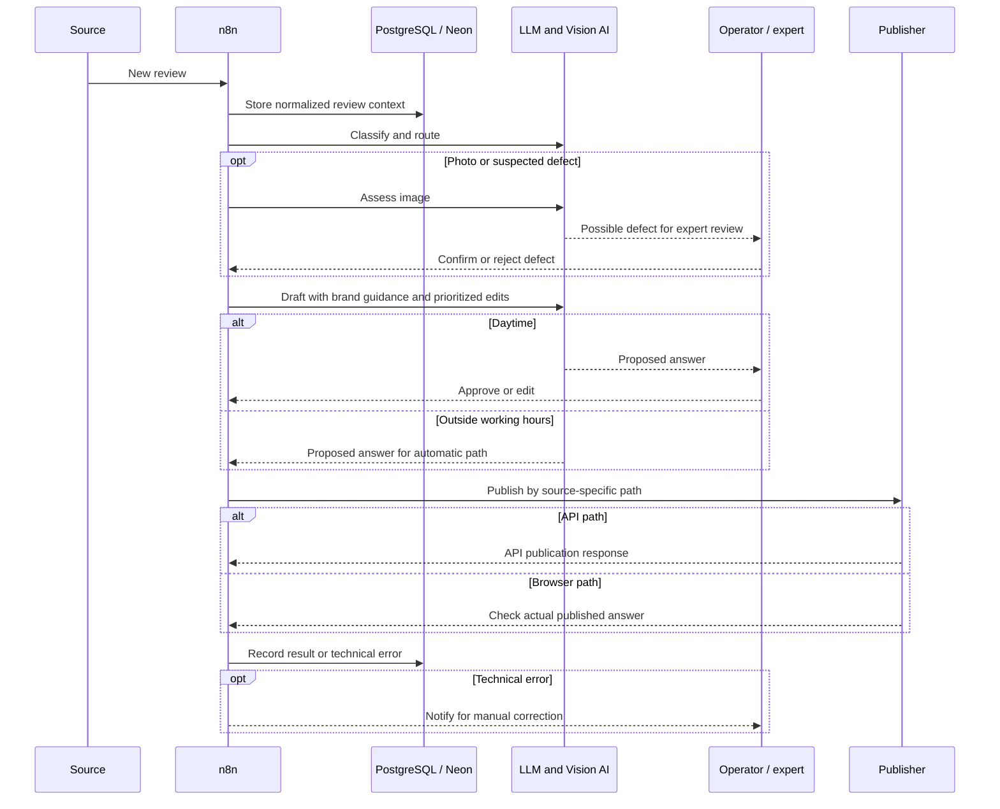

# Multi-channel AI review automation

**Applied AI engineering case study · architectural reconstruction of a historical system**

I designed a multi-source workflow for triaging customer reviews, drafting brand-consistent responses, and publishing them across API and browser-based channels. This repository reconstructs the architecture from recollection after the original n8n workflow exports were lost. It contains documentation and fictional examples, **not** the original workflow JSON, production code, a deployable system, or independently audited performance data.

> **Scope and evidence.** The source integrations below are remembered at the platform level. There were approximately five independent n8n ingestion workflows, but their exact number and source-to-workflow mapping cannot be verified. The project included Ozon, Wildberries, Telegram, Yandex services, Yandex Maps, 2GIS, and other sources; this is not an exhaustive or precisely counted list.

## Why it mattered

Reviews arrived through channels with different APIs, publishing paths, and operational expectations. An operator had to read, assess, draft, and publish responses while preserving brand tone and escalating possible product defects. The engineering problem was to reduce repetitive work without allowing an LLM to make unsupported defect claims or improvise compensation.

The design joined independent ingestion flows to a shared PostgreSQL database hosted on Neon, then routed each review through classification, response drafting, human control, and a channel-specific publishing path.

## Architecture at a glance

```mermaid
flowchart LR
    A[Ozon / Wildberries / Telegram] --> I[n8n ingestion workflows]
    B[Yandex services / Yandex Maps / 2GIS / other sources] --> I
    I --> D[(PostgreSQL on Neon)]
    D --> C[LLM classification and routing]
    C --> H{Response path}
    H -->|Routine| G[Draft from templates and brand guidance]
    H -->|Photo or suspected defect| V[Vision AI assessment]
    V --> E[Expert confirms or rejects defect]
    E --> G
    H -->|Ambiguous matching| M[Additional LLM comparison]
    M --> G
    G --> R[Operator edit history informs later drafts]
    R --> P{Operating mode}
    P -->|Daytime| O[Manual approval]
    P -->|Outside working hours| U[Automatic path]
    O --> Q{Publisher}
    U --> Q
    Q -->|Ozon / Wildberries / Telegram| API[n8n API publishing]
    Q -->|Other sites| PY[Python HTTP service: new Chrome per task]
    API --> X[API response confirms publication]
    PY --> Y[Check actual published response]
    X --> Z[Published state or error notice]
    Y --> Z
```

The diagram shows functional stages, not a recovered node-by-node workflow. It should not be read as a claim that every source used the same set of stages or that every stage ran for every review.

## Engineering decisions

| Decision | Reason and boundary |
| --- | --- |
| Independent n8n ingestion workflows | Keep source-specific intake logic separate while converging on one data store. The precise count and mapping are unknown. |
| Shared PostgreSQL/Neon | Give classification, drafting, operator work, and publication a common record of review context and state. The historical schema is unavailable. |
| LLM classification and routing | Identify the appropriate path and response context before drafting. Exact model names and prompt versions for this stage are not recoverable. |
| DeepSeek via OpenRouter for drafting | Compose replies using templates and brand guidance. Prioritized operator corrections influenced subsequent drafts through history/context, **without fine-tuning**. |
| Human checkpoints | Daytime responses were manually approved. Photo reviews used Vision AI, but a domain expert had to confirm any defect conclusion. |
| Deterministic commercial decisions | Compensation and replacement alternatives were calculated by rules; an additional LLM comparison helped resolve ambiguous matches. The LLM was not the calculator or final defect authority. |
| Channel-specific publication | Ozon, Wildberries, and Telegram used API calls in n8n. Other sites used an HTTP call to a separate Python service that launched a fresh Chrome instance per task. |
| Publication verification | An API response confirmed publication on API channels; browser-based paths checked that the response was actually published. Technical failures generated notices for manual correction. There were **no automatic retries or self-healing**. |

## Operating sequence

## Outcome and limits

The operator recalled daily manual effort falling from **about 6 hours to about 1 hour**, and later to **about 15 minutes even as review volume grew**. These are **self-reported estimates**, not time-study results. No source dataset, review counts, error rates, or controlled before/after measurements survive, so the figures should not be interpreted as audited productivity or causal estimates.

The system still required human attention: daytime approval, expert confirmation of defects, and manual repair after technical failures. Browser publication depended on a fresh Chrome session for each task and the continued stability of external sites. Automatic handling outside working hours increased throughput but also made the quality of routing, templates, and escalation rules important.

## Read the case

- [Technical case study](docs/technical-case-study.md): decision boundaries, failure handling, and what cannot be reconstructed.
- [Fictional walkthroughs](examples/fictional-walkthroughs.md): safe illustrations of routine, defect, and publication-failure paths.

## Recruiter summary

**Applied AI Engineer — multi-channel review operations.** Designed n8n-based ingestion, PostgreSQL/Neon state, LLM routing and brand-guided drafting, human approval, expert-gated Vision AI, deterministic compensation logic, and verified API/browser publication. Historical architecture reconstructed from recollection; original workflow exports and production data are unavailable. Self-reported operator time declined from roughly 6 hours a day to 1 hour, then about 15 minutes as volume increased.

## Disclosure

No customer data, real reviews, credentials, original workflow exports, production screenshots, or proprietary prompts are included. The examples are invented to explain decision boundaries. Tool and model details are named only where recalled; browser automation libraries, HTTP frameworks, specific model versions, exact workflow counts, and deployment topology are intentionally unspecified.

