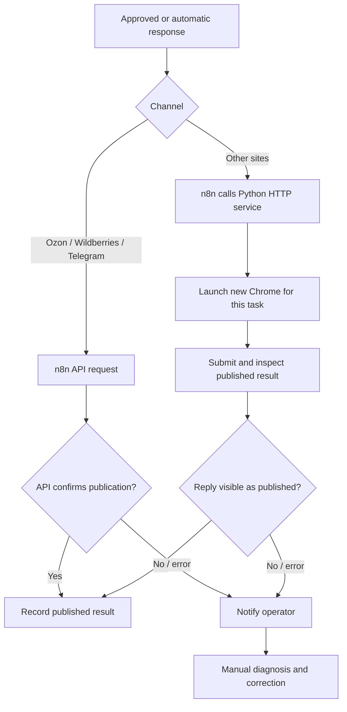

# Technical case study: a reconstructed multi-source review system

**Status:** retrospective architectural reconstruction. The original n8n JSON and production artifacts are unavailable. This document records the user's recollection and marks design interpretation where needed. It is not implementation documentation for a working release.

## 1. Problem and system boundary

The operating team needed to answer reviews appearing on marketplaces, messaging channels, map listings, and other services. The response process combined customer communication with product judgment: some messages were routine, while images or ambiguous product references could require expert intervention. Publication also differed by platform. A single response-generation prompt could not solve intake, decision making, approval, publishing, and confirmation.

The remembered solution used roughly five independent n8n ingestion workflows feeding one PostgreSQL database on Neon. Ozon, Wildberries, Telegram, Yandex services, Yandex Maps, and 2GIS were among the sources. The exact workflow count, source grouping, field mapping, schedules, schema, and platform coverage are not available. Consequently, the architecture diagrams describe logical responsibilities rather than reconstructed configuration.

## 2. Intake and shared state

Each source had its own intake path in n8n. Shared PostgreSQL storage enabled later stages to work from a common review context and keep track of operator edits and publishing outcomes. Normalization is a reasonable architectural description of the convergence step, but no historical field schema or deduplication strategy has been recovered. The public case therefore avoids invented table names, idempotency keys, polling intervals, queues, or retention policies.

The critical operational distinction was **drafted versus published**. A generated response was not treated as proof that the channel had accepted it. API channels relied on the API's response; browser channels checked the visible publication result. A technical error resulted in notification and a person's subsequent fix.

## 3. Classification and response composition

An LLM classified incoming reviews and routed them to an appropriate handling path. Response drafting used DeepSeek through OpenRouter, constrained by templates and brand guidance. The system retained a history of operator corrections, prioritized those edits, and supplied them as context for later drafts. This was contextual adaptation, **not model fine-tuning**. The exact prompts, ranking algorithm, context window, and model version are unknown.

For routine messages, the design could produce a draft for approval or automatic publication depending on the time-based operating mode. Daytime responses went through manual approval. Outside working hours, an automatic mode was available. The available recollection does not establish exact hours, thresholds, or whether every category was eligible for automation; the diagram's automatic branch is therefore a mode, not a blanket assurance that all cases bypassed review.

## 4. Product judgments and safeguards

Photo reviews could be inspected with Vision AI. A suspected defect still required **expert confirmation**; image analysis alone did not establish a product defect. Where compensation or replacement was appropriate, alternatives were calculated deterministically. An additional LLM comparison was used for ambiguous matching cases, but it did not replace the calculation rules. Exact compensation policies, product catalogs, and approval authorities are not public and have not been reconstructed.

This separation matters because the consequences differ. Tone and wording can be revised by an operator; a false defect finding or invented remedy can create an operational commitment. In this case, the AI assisted triage and language generation while expert judgment and deterministic calculations constrained substantive decisions.

## 5. Publication and verification

Ozon, Wildberries, and Telegram responses were published through APIs orchestrated by n8n. For other sites, n8n invoked a separate Python HTTP service. That service started a **new Chrome instance for each task** and checked whether the answer had actually appeared. The remembered rationale for a fresh browser process was to avoid problems from reusing a previous instance; no automation library or Python web framework is confirmed.

For API publication, the API response was the confirmation signal. For browser publication, the service verified the actual posted reply. These were channel-specific confirmation methods, not a universal end-to-end guarantee. On technical failures, the system alerted the operator, who fixed the issue manually. It did **not** automatically retry, heal itself, or guarantee exactly-once publication. The historical record does not support claims about retry queues, circuit breakers, observability platforms, or uptime.

## 6. What the outcome supports

The operator's retrospective estimate was approximately **6 hours of manual work per day before automation**, then **1 hour**, and later **15 minutes despite growing review volume**. That supports a qualitative conclusion that the process reduced routine effort for this operator. It does not establish review throughput, statistical confidence, response quality, customer satisfaction, revenue effect, labor-cost savings, or an independently verified percentage reduction. Those measurements were not supplied.

The estimate also spans a changing workload. Without timestamps, baselines, and volume series, the final 15-minute figure should not be used to calculate a controlled improvement ratio. Recruiter-facing summaries should preserve the words **self-reported** and **approximately**.

## 7. Trade-offs and limitations

| Area | Benefit | Limitation or residual risk |
| --- | --- | --- |
| Separate ingestion flows | Source-specific logic is easier to isolate. | Cross-source consistency depends on the shared representation; historical mappings are lost. |
| LLM drafting with edit history | Operator preferences could influence later answers without training a new model. | Context selection and prompt behavior are unavailable for audit. |
| Manual approval during the day | Operators can correct tone or factual errors before publishing. | Adds latency and labor. |
| Automatic mode outside working hours | Responses can continue when an operator is absent. | Routing and guardrails matter more when immediate review is unavailable. |
| Vision AI with expert gate | Images can flag issues while a human retains defect authority. | Expert review remains a throughput constraint. |
| Deterministic remedy calculation | Avoids letting generated prose invent compensation math. | Rules require maintenance and policy ownership. |
| Browser publication with fresh Chrome | Avoids persistent browser-state problems remembered by the operator. | Slower and sensitive to changes in external interfaces. |
| Notify-and-repair on technical failure | Keeps a person aware of incidents. | No automatic recovery; delays and missed notices remain possible. |

## 8. Evidence and non-claims

The evidence for this repository is the project owner's account of the historical system. A previously attached `CLAUDE.md` described a narrower Ozon CSV, Telegram, and Vision flow; it may represent another version or subset and is **not** evidence for the full multi-source architecture. It also contained a database credential, so it is intentionally absent from this repository. The original exports, code, logs, screenshots, customer data, and quantitative records are not available here.

This repository does not claim a runnable implementation, exact workflow count, complete platform inventory, specific browser automation package, Python HTTP framework, particular vision model, automatic retries, self-healing, or independently verified impact. The diagrams and fictional examples are explanatory artifacts only.

## 9. Interview discussion points

1. **Where AI belonged:** language understanding, routing, drafting, and ambiguous comparison; deterministic rules and domain expertise handled consequential decisions.
2. **How operator feedback was used:** prioritized edit history as context, without fine-tuning or pretending that a model had permanently learned from a correction.
3. **How completion was defined:** a published response confirmed by the relevant API or a browser-side check, not merely a successful draft.
4. **Where reliability stopped:** notification and manual repair on technical failure, with no remembered automated recovery loop.
5. **What cannot be reproduced:** original n8n configuration and private operating data; this case preserves design reasoning rather than source artifacts.

